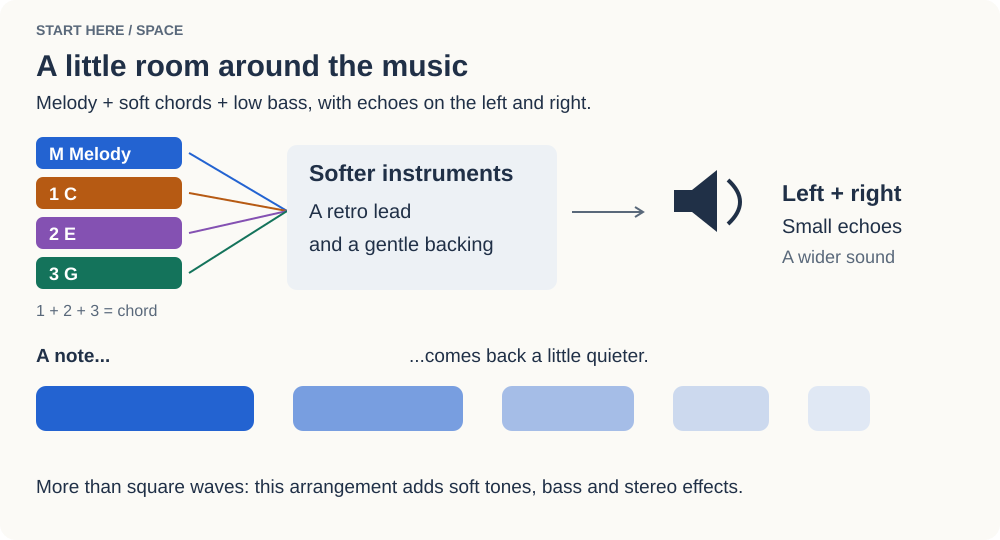
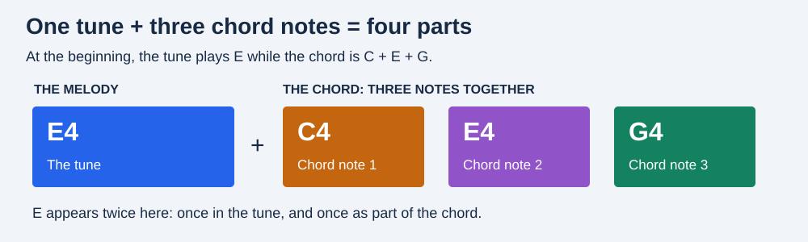
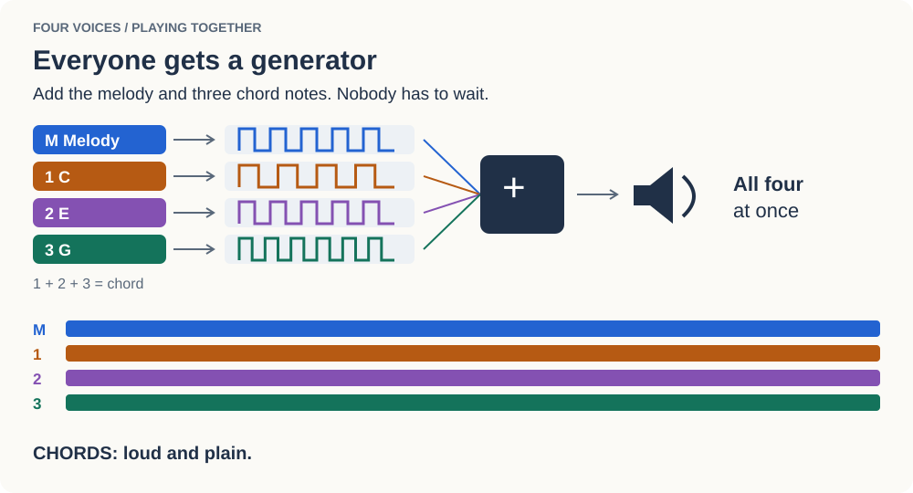
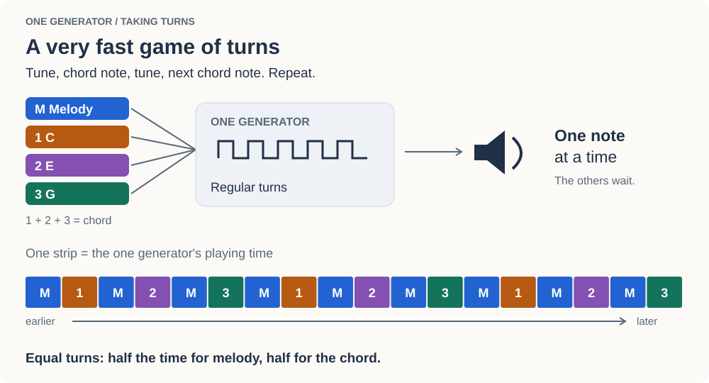
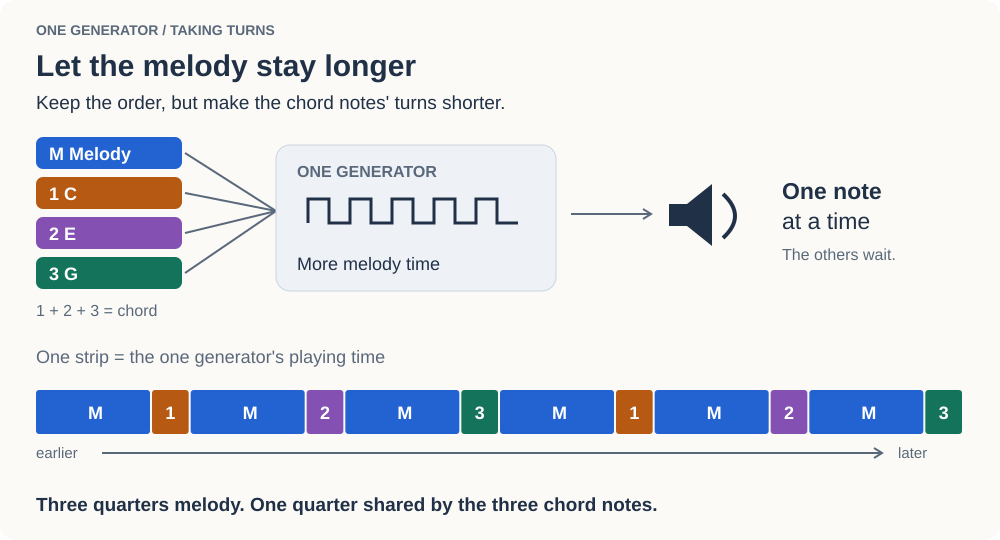
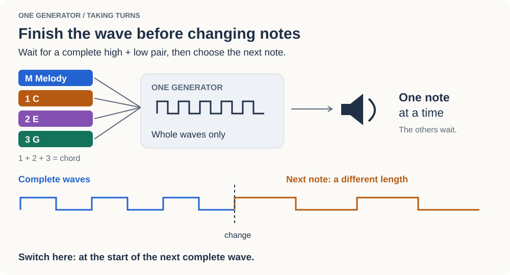
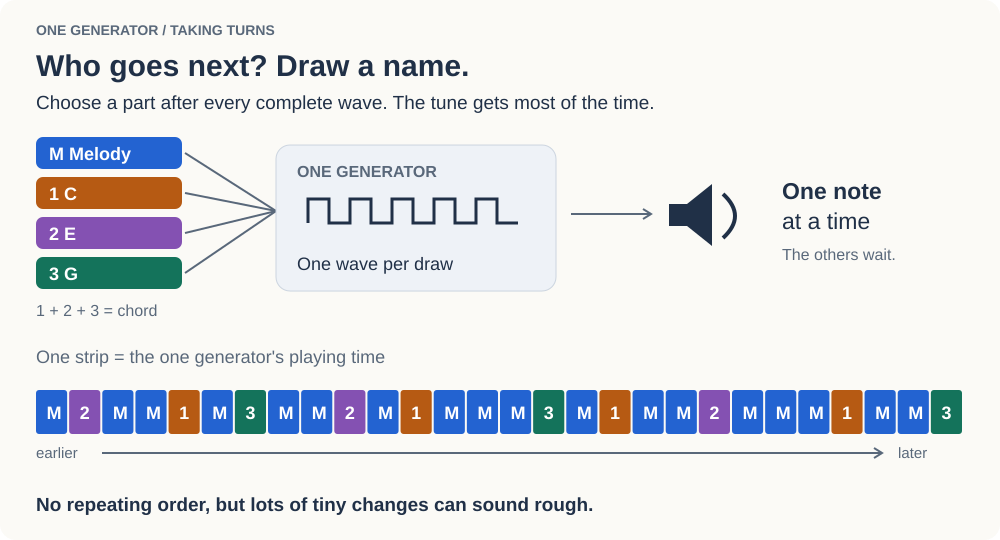
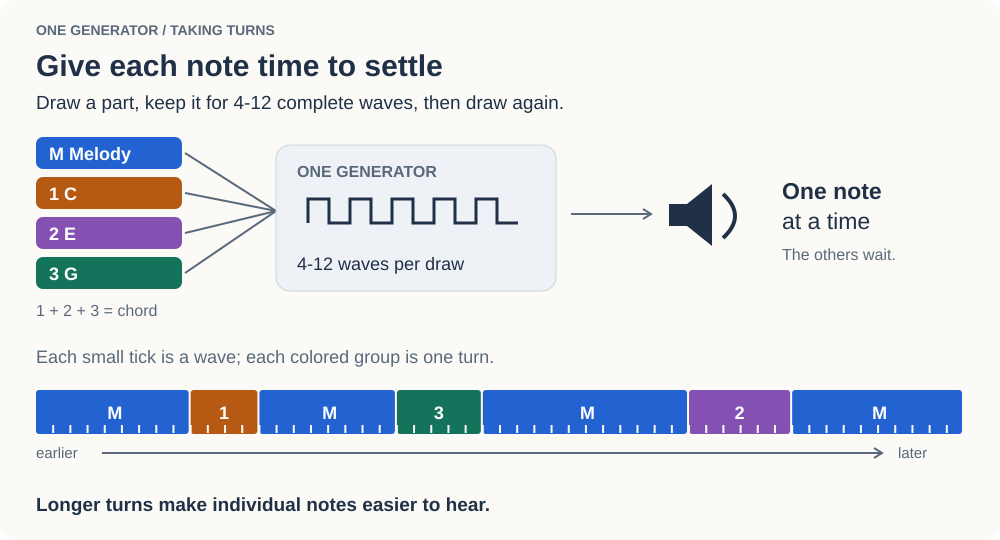
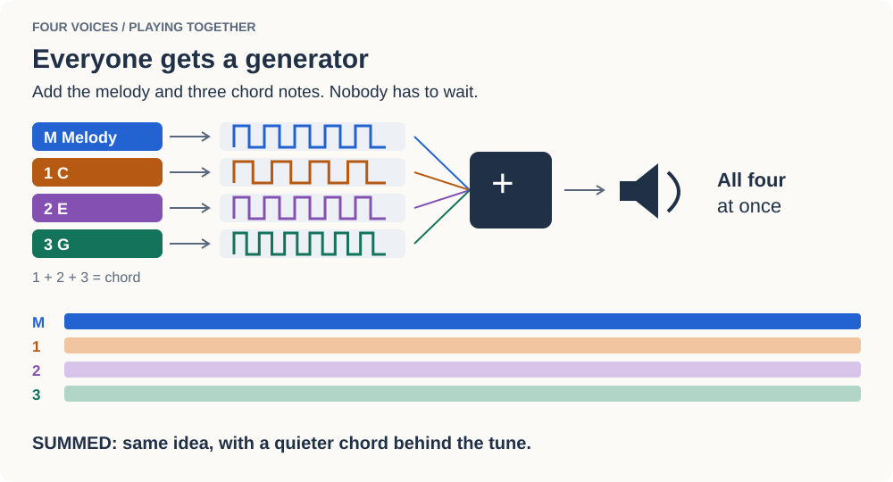

# Square Wave Lab

What happens when you try to squeeze a melody and a chord through one tiny sound generator?

We tried it. It buzzed. We changed the timing. It crackled. Then we let the notes stay a little longer, and things started to sound musical.

This is that little journey, with the same *Ode to Joy* in eight versions you can hear and compare.

## First, have a listen

### [Play Space: melody, soft chords, bass and a little echo](ode_space.wav)



This one has room to breathe. It mixes a retro lead with softer sounds, spreads the backing across your headphones and adds a little echo. Start here, then follow the experiments below to hear what happens when we make the sound much simpler.

## What are we playing?

There are **four parts: one melody and three notes making a chord**.

The melody goes **E, E, F, G...** The backing starts with a C-major chord: **C + E + G**. Each of those three notes is its own part. Later, the chord changes while the melody carries on.

Imagine four players. Can they all play together, or do they have to share one instrument and take turns?



A **generator** makes a repeating sound wave. A square-wave generator flips between a high and a low level; how quickly it repeats decides which note we hear.

## Follow the experiments

Follow the four colors: blue is the melody; orange, purple and green are the three chord notes. **M** means melody, and **1, 2, 3** are the chord notes. The pictures show how each version works.

### 1. Chords: everyone plays together



[Listen to Chords](ode_chords.wav) - `python square_wave_lab.py chords`

One square-wave melody, with three square-wave notes underneath. Add the four signals together and we get a tune with a chord behind it. It works, but sounds fairly plain. This is also the loudest version here, so turn it down a little when comparing.

### 2. Switch: share one generator



[Listen to Switch](ode_switch.wav) - `python square_wave_lab.py switch`

Now there is only one generator. It takes turns: **melody, chord note 1, melody, chord note 2, melody, chord note 3**, then around again. The melody gets half the time and the chord gets the other half. We hoped this would sound like several players. The regular switching has a sound of its own: a noticeable buzz or flutter.

### 3. Less chord: give the tune more time



[Listen to Less Chord](ode_less_chord.wav) - `python square_wave_lab.py less-chord`

The melody now gets three quarters of the time, leaving one quarter for the chord notes. The tune stands out more, but shortening the backing changes its texture too. Giving a note less time is different from turning down its volume.

### 4. Full cycles: finish the wave first



[Listen to Full Cycles](ode_full_cycles.wav) - `python square_wave_lab.py full-cycles`

Before changing notes, the generator now finishes a complete **high-then-low** wave. We also add tiny gaps between melody notes, so **E, E** does not become one long **E**. The pulses are more orderly, but we can still hear the regular switching.

### 5. Random: pick the next player



[Listen to Random](ode_random.wav) - `python square_wave_lab.py random`

At the end of each wave, we draw the next part at random. The melody gets most of the chances. There is no repeating turn-taking pattern now, but all those tiny unpredictable changes make the sound rougher. This was a useful surprise: random did not mean smoother.

### 6. Packets: let each player stay a while



[Listen to Packets](ode_packets.wav) - `python square_wave_lab.py packets`

Instead of drawing after every wave, keep the selected part for **4 to 12 complete waves**. Then draw again. The notes have a little time to settle, and the melody becomes easier to follow. This was our favorite of the one-generator experiments.

### 7. Summed: give everyone their own generator



[Listen to Summed](ode_summed.wav) - `python square_wave_lab.py summed`

Four square-wave generators run at once: one for the melody, three for the chord. We add their outputs, keeping the backing quieter than the tune. No player has to wait. This is **polyphony: several notes sounding together**.

It sounds much like the first Chords version because that one was already doing the same basic thing! We came back to four voices after hearing what happens when they have to share. Here the oscillators keep their own timing, and the chord group is quieter.

Each generator makes a square wave. Their **sum has more than two levels**, because the four signals can add up in different ways.

## Try it yourself

```sh
python -m pip install -r requirements.txt
python square_wave_lab.py
```

With no version name, you get Space. Every run saves the complete WAV beside the script and then plays it. **Ctrl-C stops playback**, leaving the recording ready to listen to again.

To hear the whole tour, starting with Space:

```sh
python square_wave_lab.py all
```

Two small controls let you explore further:

```sh
# Give chord notes 15% of the time in a one-generator experiment.
python square_wave_lab.py packets --chord-share 0.15

# Set the whole chord group's volume relative to the melody.
python square_wave_lab.py summed --chord-volume 0.3
```

`--chord-share` works with Switch, Less Chord, Full Cycles, Random and Packets. Switch starts at 50%; the others start at 25%. Random versions aim for that balance over time, so a short passage can lean one way or the other. The same random seed is used each time, making comparisons repeatable.

`--chord-volume` works with Summed. Its default is 0.3 for the whole three-note chord group relative to the melody. The mixer leaves room for both so the result does not clip.

Every version has a quick **8 ms fade-in** and **15 ms fade-out** to soften the beginning and end of the file. The versions have different overall volumes; adjust playback level as you compare them.

## A peek inside

- [`music.py`](music.py) holds the melody, chords, tempo and tuning. Every version plays this same score.
- [`square_wave_lab.py`](square_wave_lab.py) contains the eight sound recipes, the WAV writer and playback.
- [`tools/build_gallery.py`](tools/build_gallery.py) rebuilds the recordings and the illustrations.
- [`tools/illustrations.py`](tools/illustrations.py) draws the diagrams; run it on its own to rebuild just the pictures.
- [`test/test_square_wave_lab.py`](test/test_square_wave_lab.py) checks timing, mixing, fades and stopping playback.

The tune has 16 bars at 120 BPM and lasts 32 seconds. Space has another second for the echoes. Recordings are 44.1 kHz, 16-bit WAV; Space is stereo and the others are mono.

In the full-cycle experiments, a note change waits for the rising edge after a complete high/low pair. Wave edges are placed on the nearest audio sample, keeping fractional timing between cycles. A slower note has a longer wave, so the random picker accounts for that when sharing the time. The sharp edges can still sound gritty: finishing whole waves does not remove all the extra sound that switching creates.

To rebuild the gallery or run the checks:

```sh
python tools/build_gallery.py
python -m unittest discover -s test -v
```

## License

[MIT](LICENSE), copyright 2026 Maciej Max.
